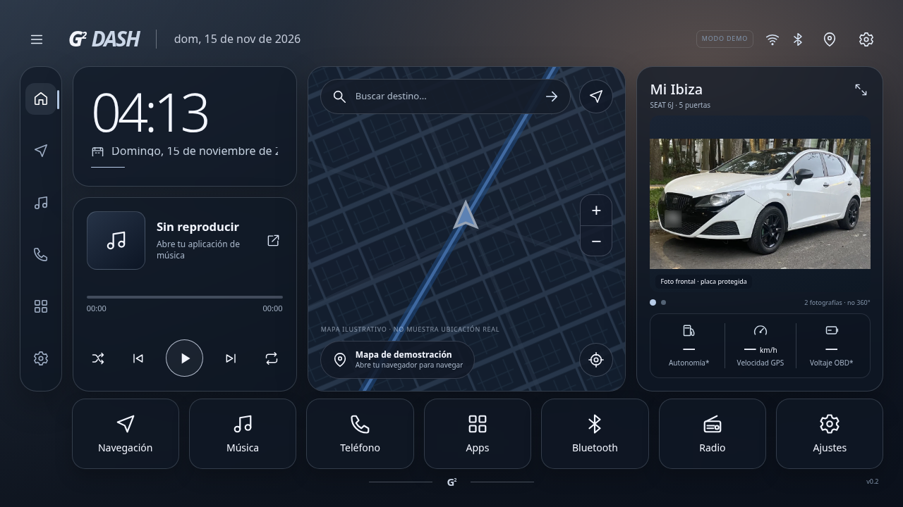

<div align="center">

# G² Dash

**Smart Car Interface · Prototipo v0.2**

Interfaz automotriz minimalista con paneles translúcidos, personalización de fondos y un espacio dedicado al vehículo.



</div>

## Estado del proyecto

**En desarrollo.** Esta versión es una **demostración web interactiva**, no un APK ni un launcher Android instalado. La meta es crear una aplicación Android propia optimizada para pantallas horizontales, especialmente 1280 × 720.

### Funciones disponibles en v0.2

- Diseño con distribución de reloj, reproductor de demostración, mapa ilustrativo y panel del auto.
- Reloj y fecha con el horario del dispositivo.
- Panel fotográfico del SEAT Ibiza 6J, con dos fotografías originales y matrículas anonimizadas para su publicación en GitHub.
- Fondos predefinidos o imagen seleccionada por el usuario.
- Opacidad de paneles, intensidad de difuminado y color de acento configurables.
- Modos automático, día y noche; ajustes guardados localmente cuando el navegador lo permite.
- Opción de solicitar velocidad GPS **si el navegador proporciona esos datos y el usuario autoriza su ubicación**.
- Búsqueda de destinos que abre Google Maps en una pestaña nueva.

### Funciones pendientes

- APK y launcher Android nativo.
- Accesos al listado real de aplicaciones instaladas.
- Controles de música integrados con Android (MediaSession).
- Integración opcional con OBD para parámetros reales del vehículo.
- Mapa integrado con proveedor cartográfico.
- Modelo 360° coherente del Ibiza; actualmente solo existen dos fotografías, no un modelo giratorio.

> **Aviso:** el mapa es una ilustración, no un mapa en tiempo real. Los campos de autonomía y voltaje permanecen vacíos hasta que exista una conexión real; no se inventan valores del vehículo. Los iconos de Wi-Fi y Bluetooth son decorativos en esta demostración web.

## Aplicación Android (v0.3 — primera prueba)

El código de la primera aplicación Android está en [android/](android/README.md).
Conserva la apariencia de la demostración y las fotografías originales del Ibiza.
Ofrece acceso nativo a aplicaciones instaladas, teléfono, Bluetooth, selección de fondos,
y permite solicitar velocidad GPS con autorización del usuario. Es un APK de prueba,
**no** sustituye todavía el launcher principal ni integra música/OBD en tiempo real.

El flujo [Android APK](.github/workflows/android-apk.yml) compila un APK de depuración
en GitHub Actions. Los artefactos aparecen en la pestaña **Actions** cuando el flujo termina correctamente.

## Probar localmente

1. Descarga el repositorio como ZIP y descomprímelo.
2. Abre `index.html` en un navegador moderno.
3. Para habilitar permisos como GPS y evitar restricciones de archivos locales, usa un servidor web HTTPS.

No se requieren Node.js, dependencias externas, cuentas ni conexión a Internet para visualizar el tablero básico.

## Publicar demo con GitHub Pages

En **Settings → Pages**, selecciona **Deploy from a branch → main → /(root)** y guarda. La URL seguirá la forma `https://USUARIO.github.io/g2-dash/` cuando GitHub termine de desplegar.

## Estructura

```text
g2-dash/
├── index.html            # Interfaz
├── style.css             # Diseño glassmorphism
├── app.js                # Interacciones y preferencias
├── assets/
│   ├── ibiza_frente_original.webp
│   └── ibiza_trasera_original.webp
├── vista_previa.png      # Captura de la demo
├── README.md
├── LICENSE              # Aviso de licencia propietaria
├── ROADMAP.md
└── .gitignore
```

## Privacidad y créditos

- Las matrículas se difuminaron únicamente en las copias destinadas a este repositorio público; la carrocería y sus detalles permanecen intactos.
- Las fotografías no incluyen permiso de reutilización por terceros.
- La aplicación no envía las fotografías ni los fondos seleccionados a ningún servidor propio.
- **Licencia propietaria — Todos los derechos reservados.** El código fuente, el diseño y la documentación originales de G² Dash no están disponibles bajo una licencia de código abierto. Consulta [LICENSE](LICENSE) para conocer el alcance y las condiciones.
- Los nombres, logotipos y marcas de terceros (incluidos SEAT e Ibiza) pertenecen a sus respectivos titulares; su presencia no implica afiliación.

---

**G² Dash** · Diseño y desarrollo iterativo · Proyecto personal de interfaz automotriz.
