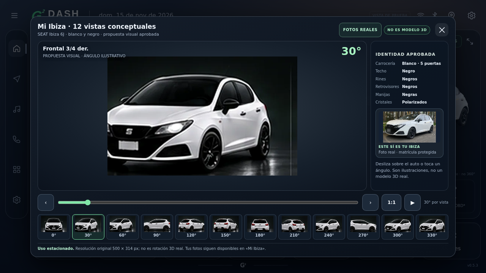
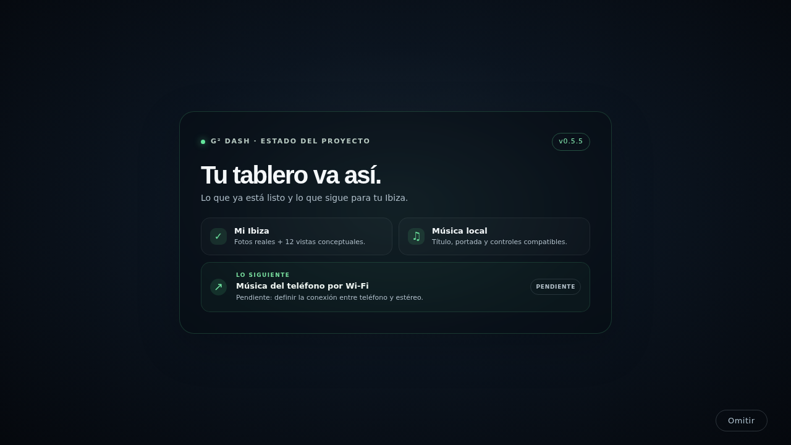

# Hoja de ruta — G² Dash

## Situación actual

La versión **v0.5.2 (desarrollo)** agrega el reproductor ampliado para la sesión musical local, además del centro de Apps y el visor conceptual. La foto frontal original permanece como vista principal, separada del concepto. Falta validar la aplicación en el Gearelec físico. La música del teléfono por Wi‑Fi, el mapa real, OBD y HOME definitivo siguen pendientes.

| Versión | Objetivo | Estado |
|---|---|---|
| v0.1 | Distribución inicial y fotografías del Ibiza | Completada |
| v0.2 | Iconos, apariencia, fondos y demo web | Completada |
| v0.3 | Tres estilos de logotipo y widgets ahumados ajustables | Completada |
| v0.4 | APK Android de prueba, acceso a apps instaladas y GPS opcional | Implementada; validación en estéreo pendiente |
| v0.4.1 | Música Android local: título, artista, portada y controles compatibles | Implementada; requiere permiso multimedia |
| v0.4.2 | Máscara corregida sobre la foto real y diseño adaptable | En código; falta revisar y aprobar la máscara |
| v0.4.3 | Emblema SEAT → saludo Doble G → tablero; selección HOME opcional | Implementado en código; probar encendido real |
| v0.4.4 | Foto frontal completa por defecto; vista trasera y recorte transparente opcional | Implementada; comprobada en capturas; falta validar en el estéreo |
| v0.4.5 | Bienvenida con saludo y resumen honesto de avances y siguientes pasos | Implementada en web y APK; captura real publicada |
| v0.5.0 | Galería conceptual del Ibiza: 12 vistas y controles táctiles | Integrada en web y APK; validar en Gearelec |
| v0.5.1 | Centro de Apps: iconos reales, búsqueda, favoritos y apertura validada | Implementado en código; probar en Gearelec |
| v0.5.2 | Reproductor ampliado, portada y búsqueda de posición condicionada a MediaSession | Implementado en código; probar en el Gearelec |
| v0.5.3 | Música desde el teléfono por Wi-Fi con protocolo o app complementaria | Pendiente de definir |
| v0.6 | Mapa real con proveedor seleccionado | Pendiente |
| v0.7 | Integración OBD opcional para datos reales del vehículo | Pendiente |
| v0.8 | Medir rendimiento en pantalla 1280 × 720 y estéreo con 2 GB de RAM | Pendiente |
| v1.0 | APK estable y launcher probado en el dispositivo | Pendiente |

## Qué ya funciona

- **Marca:** G² verde, DASH blanco y línea verde; variantes APEX, PULSE y ORBIT.
- **Widgets:** grafito, azul humo, verde humo o negro; opacidad y difuminado ajustables.
- **Música local Android:** muestra metadatos y portada del reproductor que funciona en el estéreo, con vista ampliada y avance condicionado a ACTION_SEEK_TO; reproducir/pausar, anterior y siguiente cuando lo permite el reproductor.
- **Apps:** panel interno con iconos reales de aplicaciones instaladas en el estéreo, búsqueda y favoritos locales; demo web marcada como ejemplo.
- **Visor conceptual Ibiza:** 12 vistas WebP con flechas, miniaturas, selector por grados, deslizamiento y recorrido automático; marcado como propuesta visual, no modelo 3D.
- **Capturas visuales:** el flujo de GitHub documenta la pantalla y cada sección después de cada subida a `main`.

## Revisión visual del Ibiza

La v0.4.4 abre el panel con la fotografía frontal completa del Ibiza, sin aplicar el contorno todavía aproximado. La fotografía trasera y el recorte transparente siguen disponibles como opciones. No se editaron las fotos originales ni el fondo, la distribución, el logotipo o los widgets del tablero.

### Galería conceptual v0.5.0

El botón **12 VISTAS** abre la propuesta aprobada con miniaturas, selector, deslizamiento y recorrido opcional. Son ilustraciones; no son fotos reales del vehículo ni una reconstrucción geométrica.

### Bienvenida y estado del proyecto v0.5.2

Al abrir G² Dash, la tercera pantalla resume qué está listo y deja la música del teléfono por Wi‑Fi como siguiente etapa pendiente. La galería conceptual de 12 ángulos ya forma parte del tablero. La secuencia dura aproximadamente 4.6 segundos y se puede omitir.

[Ver fotos reales v0.4.4](docs/capturas/CAMBIOS_v0.4.4.md) · [Ver visor conceptual v0.5.0](docs/capturas/CAMBIOS_v0.5.0.md) · [Capturas v0.5.2](docs/capturas/README.md) · [Referencia aprobada](docs/IBIZA_360_REFERENCIA_APROBADA.md)

## Decisiones visuales

- Al ajustar el logotipo, cambiar únicamente sus letras; conservar fondo y fotografías.
- Mantener las fotografías reales del Ibiza 6J blanco de cinco puertas con sus detalles negros.
- Proteger las placas en las capturas públicas.
- Mantener la foto completa como vista inicial; dejar el recorte aproximado disponible como alternativa hasta completar la revisión visual.

## Límites y siguientes trabajos

- MediaSession y el reproductor ampliado muestran música reproducida en el Android del estéreo. Conectar un teléfono al punto de acceso no comparte automáticamente canción ni portada; el canal remoto sigue pendiente.
- El mapa sigue siendo ilustrativo.
- Autonomía y voltaje requieren conexión OBD compatible; no se inventan valores.
- La galería conceptual de 12 ángulos ya está integrada; un giro 360° real sigue pendiente de un modelo 3D validado o fotografías verificadas y consistentes de todos los lados. [Consultar referencia](docs/IBIZA_360_REFERENCIA_APROBADA.md).
- La memoria objetivo es de 2 GB; la fluidez se debe comprobar en el estéreo Gearelec antes de considerar estable el APK.
