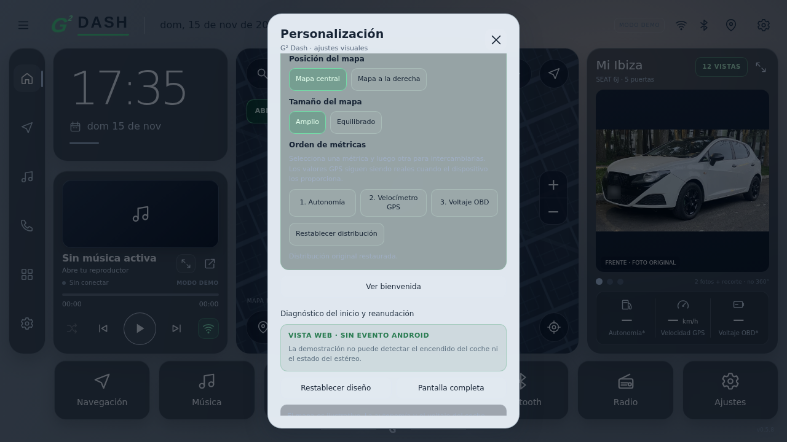
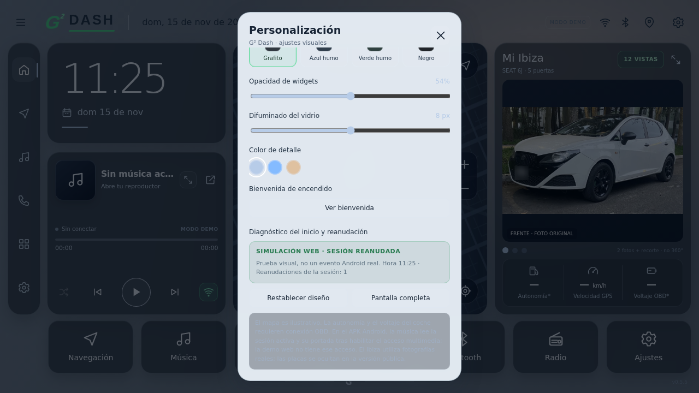

# G² Dash v0.5.5 — Arranque y regreso a HOME

## Evidencia visual del diagnóstico

| Demostración web sin datos Android | Simulación web de reanudación |
|---|---|
|  |  |

Estas son **capturas reales del HTML en Chromium**. La segunda está marcada «SIMULACIÓN WEB»: no demuestra que la pantalla, Android o el coche se hayan suspendido realmente.

## Cambios Android

- `onResume`: reanudar el WebView, ocultar las barras y refrescar reloj.
- `onPause`: pausar el WebView al dejar la aplicación.
- `onWindowFocusChanged`: recuperar modo inmersivo al obtener foco.
- `onNewIntent`: recibir el retorno HOME sin recrear la página si la actividad existe.
- `onPageFinished`: distinguir el inicio normal de una actividad reconstruida.
- `singleTask`: permitir reutilización de la actividad, según reglas de Android.
- Diagnóstico local de **la app** con último evento y contador de reanudaciones.

**No se ha implementado detección de ignición, llave ni señal ACC.** Tampoco se cambia la app HOME automáticamente.

## Checklist pendiente en el Gearelec

1. Abrir G² Dash normalmente y observar bienvenida completa.
2. Salir a Música/Maps, regresar y verificar que la bienvenida no se repite.
3. Abrir Ajustes: debería decir «SESIÓN REANUDADA» si Android emitió ese evento.
4. Apagar la pantalla y reanudar, revisar reloj, fotos, preferencias, música y táctil.
5. Si todo funciona, probar configuración HOME manual, asegurando acceso al launcher anterior.

**Conservados:** fondo aprobado, fotografías originales del Ibiza, 12 vistas conceptuales, widgets y permisos previos.

[Galería de capturas](README.md) · [Repositorio](../../README.md)
