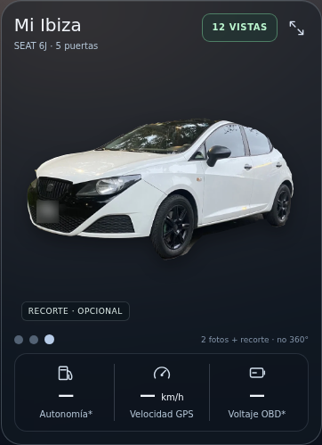

# G² Dash — Mi Ibiza v0.4.4

La vista inicial del panel ahora muestra la **fotografía frontal completa** del Ibiza. Así se conserva su aspecto real sin depender del borde todavía aproximado del recorte. La vista trasera y el recorte transparente siguen accesibles con los tres indicadores bajo la foto.

El fondo general, la distribución, el logotipo, los widgets y las fotografías originales se mantienen sin cambios. No se simula un giro 360°.

## Antes

## Ahora

## Vistas disponibles

- **Frontal:** fotografía original con matrícula protegida.
- **Trasera:** segunda fotografía original con matrícula protegida.
- **Recorte:** máscara transparente opcional; sigue en revisión y no se presenta como modelo 3D.

[Volver a la galería visual](README.md) · [Ver estado del proyecto](../../ROADMAP.md)
