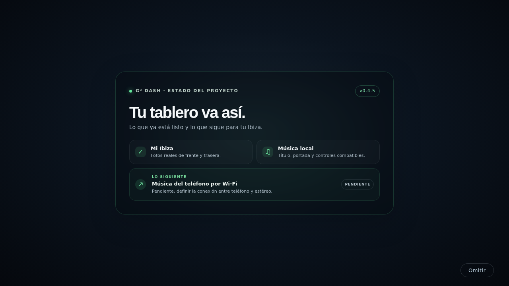

# Cambios de bienvenida — v0.4.5

La pantalla de apertura ahora explica cómo va el proyecto en una tercera vista breve. Se mantienen el emblema SEAT, la marca G² DASH, el saludo, los colores y el fondo que ya tenía la aplicación.

## Antes

La secuencia mostraba el emblema y el saludo, pero no resumía las funciones listas ni el siguiente trabajo.

## Ahora

Después del saludo, aparece una ficha de estado breve: fotos originales del Ibiza y música local con portada ya están en la app; recibir la música del teléfono por Wi‑Fi sigue pendiente de definir.

## Qué sigue pendiente

- Definir una conexión local compatible entre el teléfono y el estéreo para compartir metadatos y portada.
- Validar la app en el Gearelec de 2 GB de RAM y comprobar HOME/arranque en el equipo.

La ficha no activa la conexión Wi‑Fi ni afirma que el audio remoto funcione. El fondo del tablero, las fotos y la distribución no se cambiaron para esta actualización.
