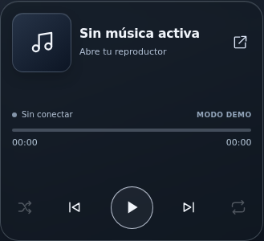
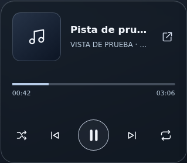
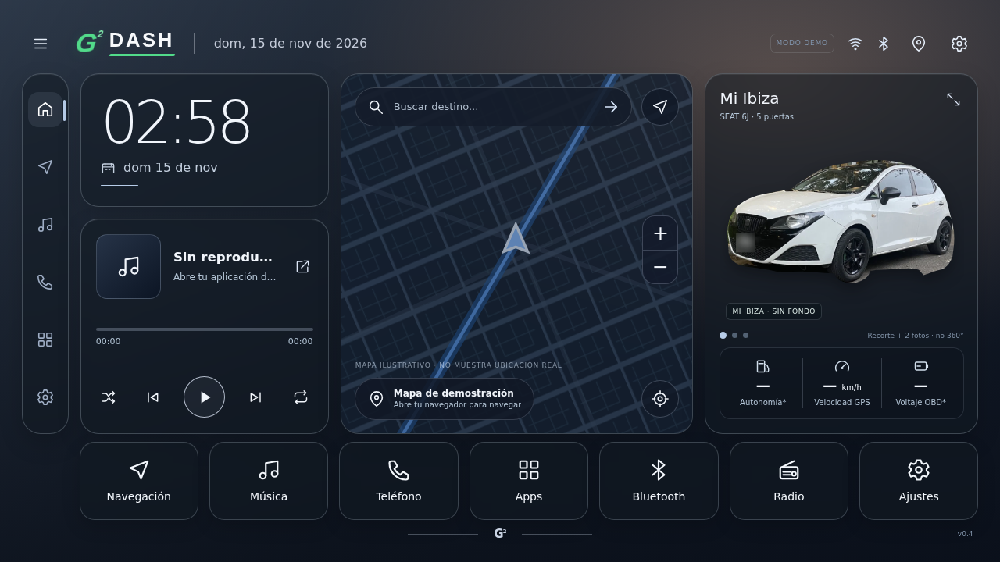
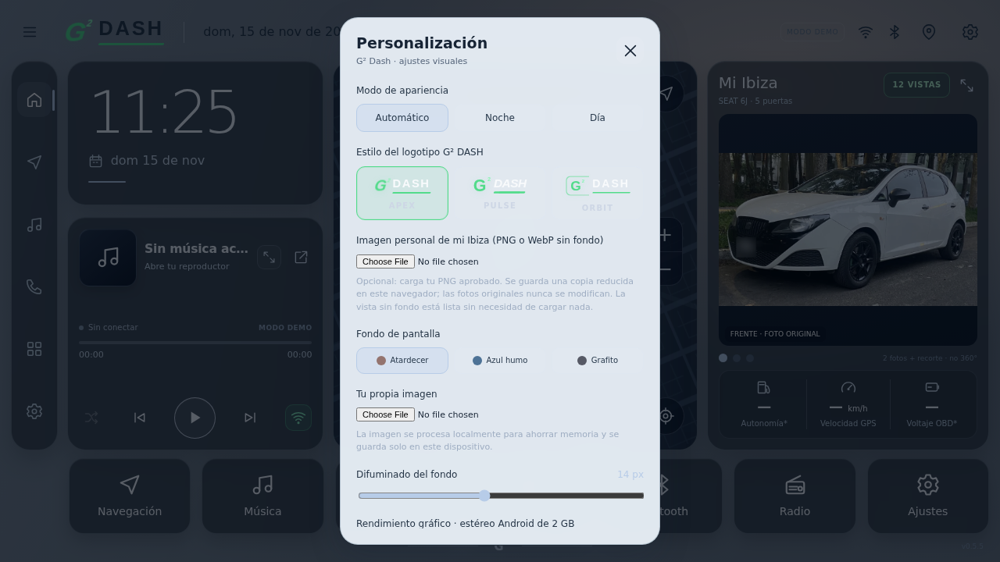
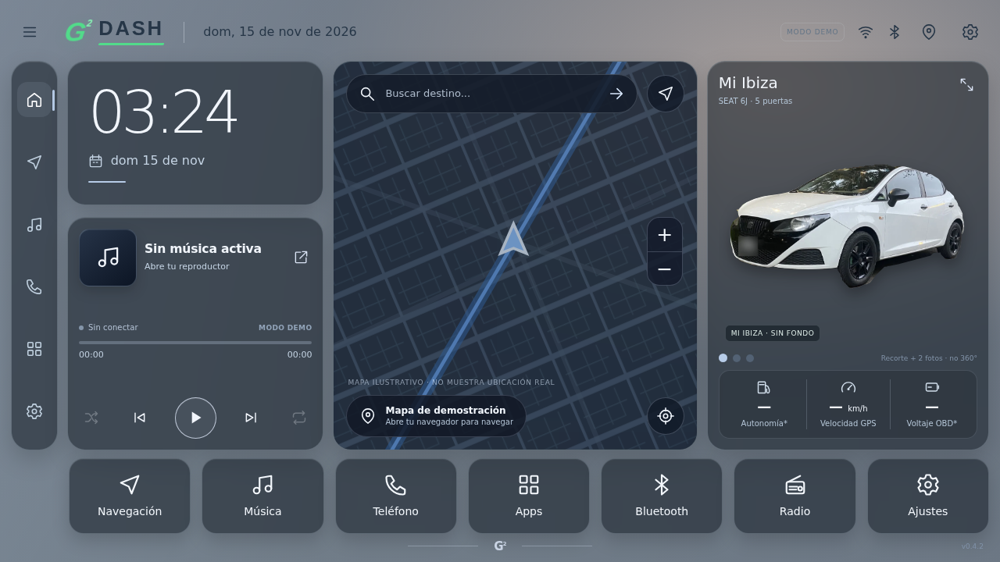

# G² Dash — Comparación visual v0.4

**Capturas reales de la interfaz web en Chromium, resolución 1280 × 720.**
Los archivos muestran pantallas capturadas del código y **no** imágenes
publicitarias o ilustraciones hechas con inteligencia artificial.

Los ejemplos de música son solo **pruebas visuales del componente**;
la música real requiere un reproductor en el Android y el permiso de
acceso a sus sesiones multimedia. **No** demuestra reproducción remota Wi-Fi.

## 1. Panel Mi Ibiza

| Antes — v0.3 | Después — v0.4 |
|---|---|
|  |  |

- El panel de vehículo conserva las fotografías originales.
- El nuevo recorte transparente es una silueta fotográfica aproximada, no
  un modelo 3D; puedes elegir la foto frontal o trasera.
- Los cambios no afectan el wallpaper general del tablero.

## 2. Widget de Música

| Antes — v0.3 (sin integración) | Después — v0.4 (vista de prueba visual) |
|---|---|
|  |  |

- Añadimos campos para portada, título, artista, duración y progreso.
- Controles de reproducción, pausa, anterior y siguiente mediante
  Android MediaSession **cuando el reproductor permite esas acciones**.
- En GitHub Pages, la captura es una **simulación visual etiquetada**.
- Música desde otro teléfono por Wi-Fi: **todavía pendiente**.

## 3. Pantalla completa

## 4. Personalización y modo día

| Ajustes | Modo día |
|---|---|
|  |  |

### Procedencia verificable

- Versión anterior: commit [`514fdf0`](https://github.com/2hpj76sd6z-cpu/g2-dash/commit/514fdf0d07ceef6ed0a3ed876d1d205af29feb11)
- Versión actual: [capturas de GitHub](actual/), archivo [`meta.json`](actual/meta.json)
- [Workflow de capturas automáticas](../../.github/workflows/capturas-visuales.yml)

Las imágenes anteriores están vinculadas a un commit fijo para conservar
la comparación incluso cuando el directorio `actual/` se actualice.
