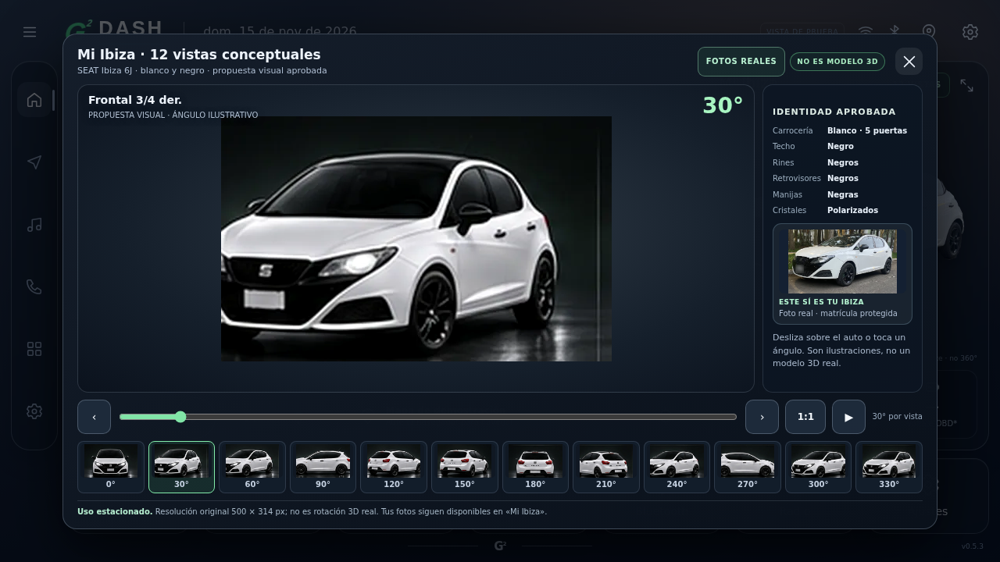
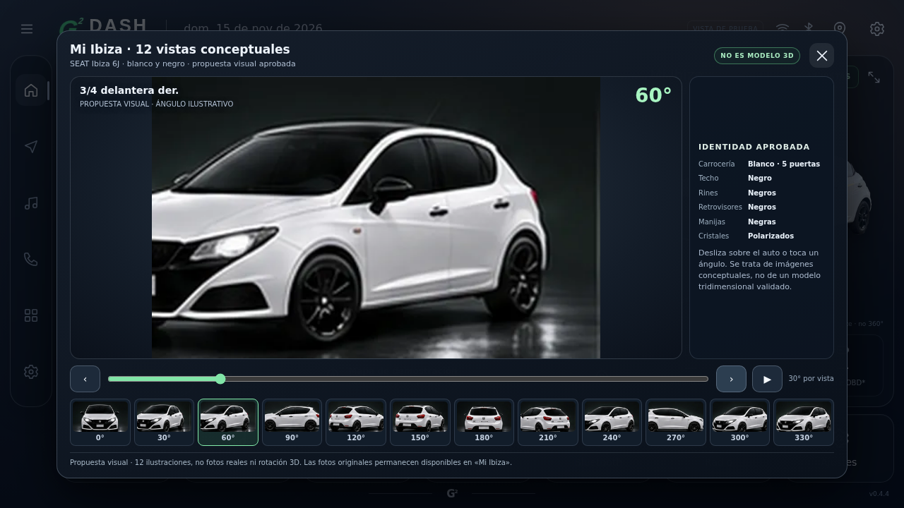
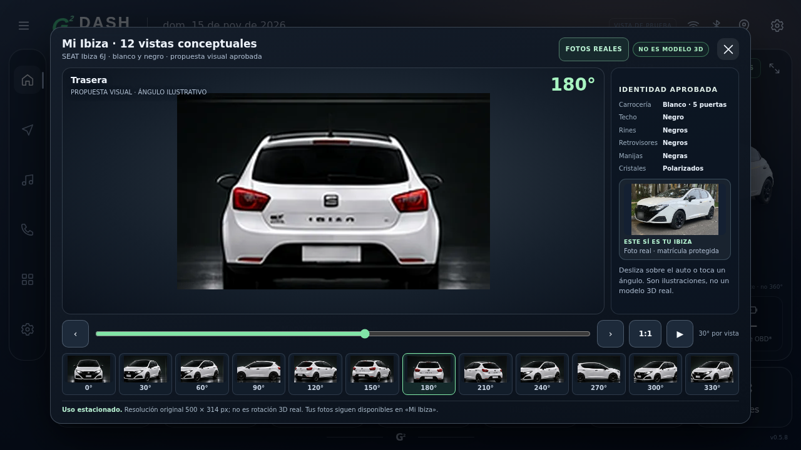

# Visor conceptual del Ibiza — v0.5.0

El panel **Mi Ibiza** conserva la foto frontal real como vista principal y suma el botón **12 VISTAS** para abrir, aparte, la propuesta visual aprobada.

## Evidencia de la interfaz

Hay flechas, miniaturas, selector de ángulo, gesto de deslizamiento y recorrido automático. La vista compacta también quedó capturada en [1024 × 600](actual/20-ibiza-conceptual-1024x600.png).

## Qué representa

Las 12 vistas son ilustraciones de la propuesta aprobada para el Ibiza 6J blanco de cinco puertas con acentos negros. **No son fotografías reales de todos los lados ni un modelo 3D geométrico validado.** El visor permanece separado de las fotos reales del coche y no altera el fondo del tablero.

La galería funciona sin WebGL ni conexión de red. Falta validar el tacto y el rendimiento en el estéreo Gearelec físico de 2 GB de RAM.
