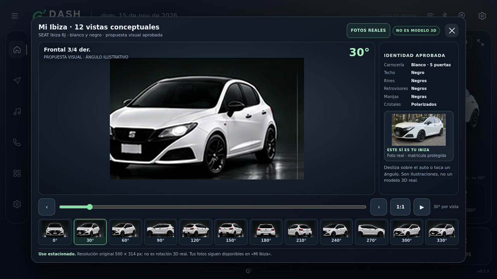
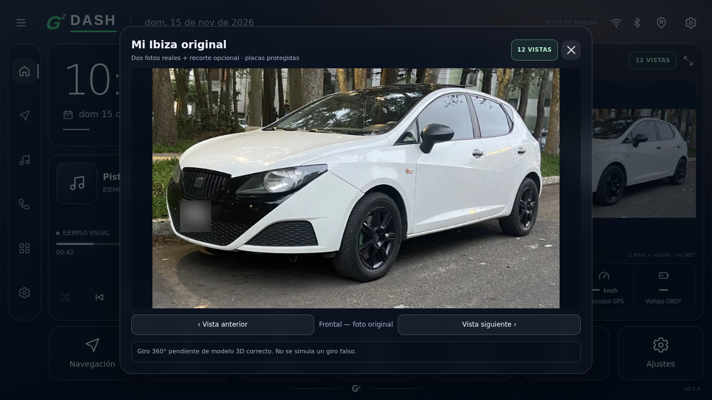
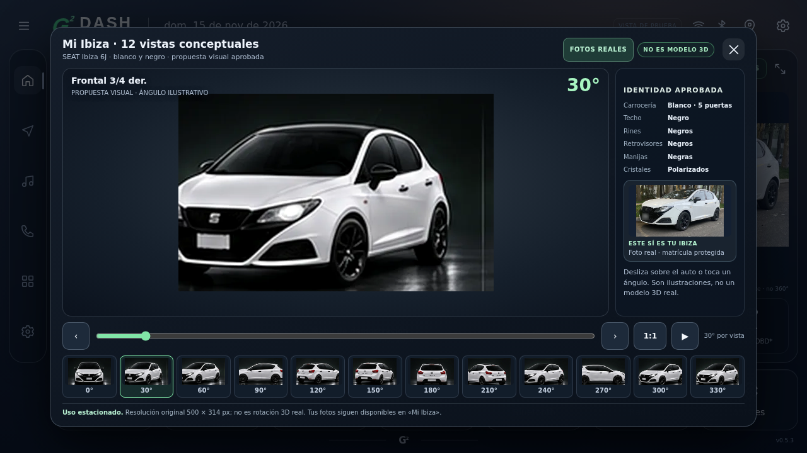

# G² Dash — Mi Ibiza real y conceptual (v0.5.3)

Las doce imágenes de la galería son ilustraciones de 500×314 píxeles, no fotografías reales de cada ángulo ni un modelo 3D. Algunos encuadres incompletos son propios de las imágenes aprobadas.

| Galería conceptual con foto real visible | Fotografía auténtica del Ibiza | Regreso a la galería |
|---|---|---|
|  |  |  |

**Cambios en la interfaz:** botón FOTOS REALES y miniatura auténtica en el panel conceptual; botón 12 VISTAS en la galería de fotos; transición sin paneles superpuestos. Mantiene el ángulo que se estaba viendo.

**Archivos que NO se alteraron:** fotos originales frontal/trasera, doce WebP conceptuales, fondo del launcher, logo G² y otros widgets. Para proteger la privacidad las matrículas permanecen anonimizadas.

[Volver a la galería](README.md) · [Proyecto](../../README.md)
