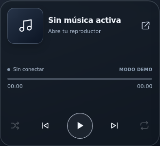
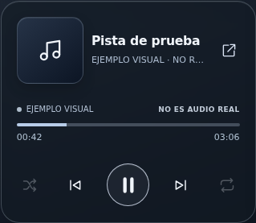

# G² Dash — Detalles de Música v0.4.1

Capturas reales tomadas del HTML/CSS/JS a **1280 × 720**.
La imagen de la derecha utiliza un **ejemplo visual identificado**, no una
sesión musical real del estéreo.

| Antes — v0.4 | Detallado — v0.4.1 |
|---|---|
|  |  |

## Cambios específicos

- Textos más legibles y compactos, sin invadir el resto del tablero.
- Estado de sesión visible mediante texto y punto de color sutil.
- Identificador del reproductor (Spotify, YouTube Music, etc.) **solo cuando
  Android entrega ese dato**.
- Aleatorio y repetir desactivados hasta implementar funciones compatibles.
- En la demo web, pulsar Play muestra un aviso; **no se enciende una
  reproducción falsa**.
- Duración/progreso reflejan los datos recibidos, sin inventar minutos ni portada.

## Verificar

La prueba de captura comprueba en navegador el texto
`EJEMPLO VISUAL`, `NO ES AUDIO REAL` y la indicación de que
no reproduce audio.

La integración real de MediaSession requiere autorizar el permiso
Android y probarla con música **en el mismo dispositivo**.
La conexión Wi-Fi a otro teléfono sigue pendiente.
