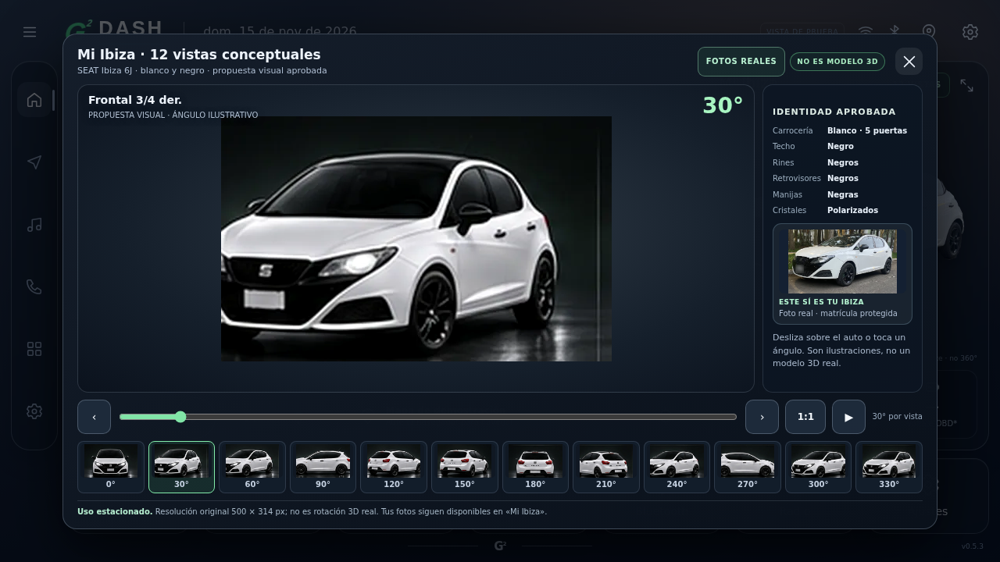
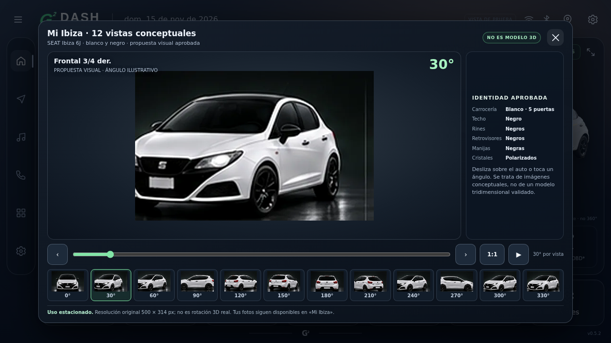
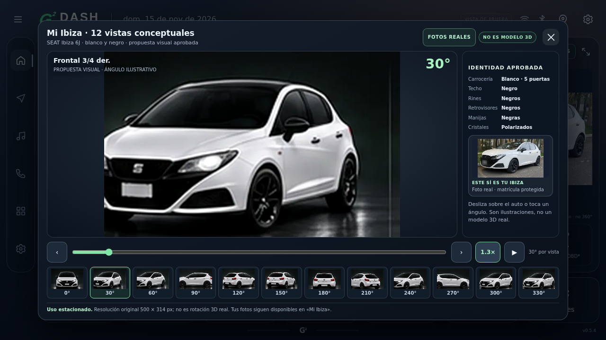
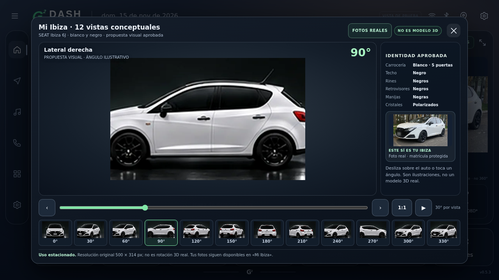

# G² Dash v0.5.1 — Nitidez y control del Ibiza

Las capturas son del **código real ejecutado en Chromium a 1280×720**.
El vehículo de 12 ángulos sigue siendo una **galería de ilustraciones**, no un modelo 3D ni fotografías reales desde todos esos ángulos.

Las doce fuentes originales miden **500×314 píxeles**. La mejora evita aumentos innecesarios; no inventa detalles de alta definición.

## Antes y después

| Antes v0.5.0 | Ahora v0.5.1 (1:1) |
|---|---|
|  |  |

## Ajuste de tamaño

| Vista 1:1 (preferida) | Vista ampliada 1.3× |
|---|---|
|  |  |

## Cambios técnicos

- Botón **1:1 / 1.3×** para controlar el reescalado.
- Contraste moderado sin alterar los píxeles de origen.
- Deslizamiento horizontal de uno a tres ángulos de 30°.
- Precarga acotada a dos vistas cercanas.
- Recorrido automático detenido al cerrar u ocultar la app.
- Miniaturas con encuadre completo, botones táctiles más grandes.
- Aviso para operar la galería únicamente **con el auto estacionado**.

Las imágenes aprobadas, las dos fotografías originales y el fondo del tablero no se modificaron. Debe comprobarse la fluidez física en el Gearelec de 2 GB.

[Galería por sección](README.md) · [Documentación técnica del Ibiza](../IBIZA_360_REFERENCIA_APROBADA.md)
