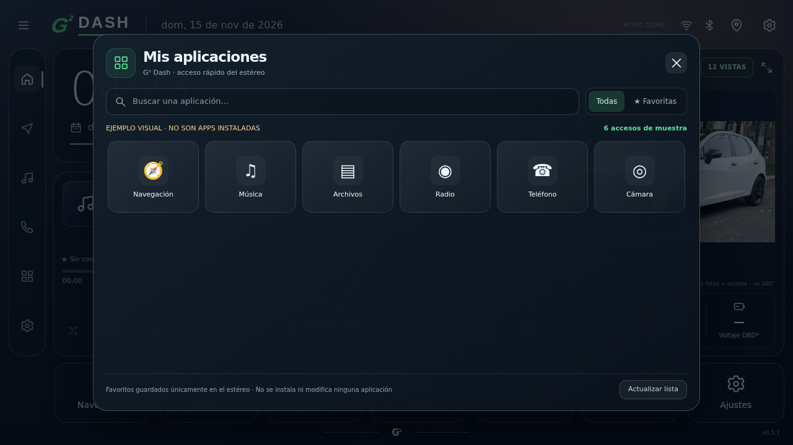
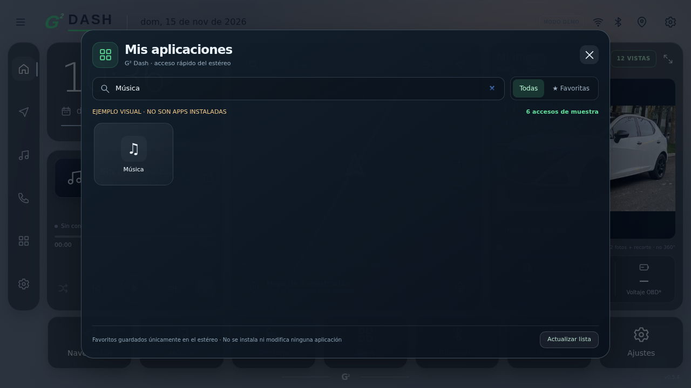
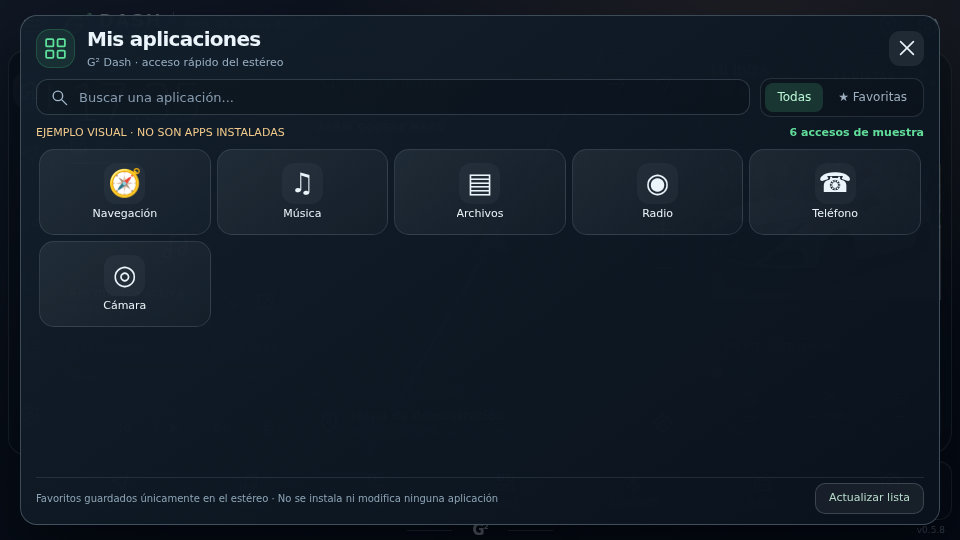
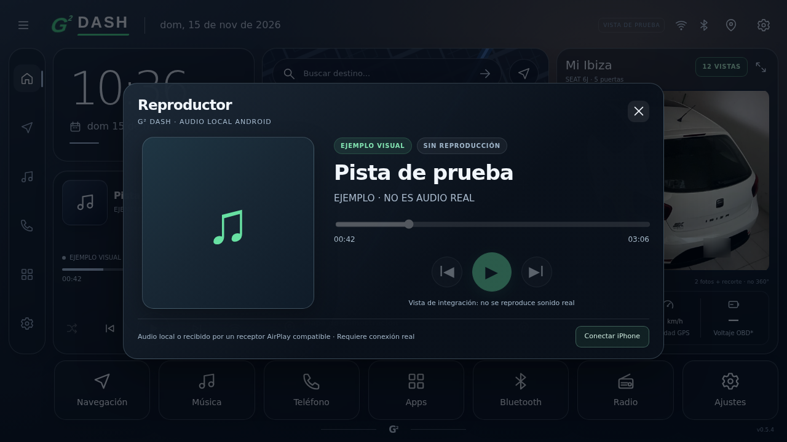
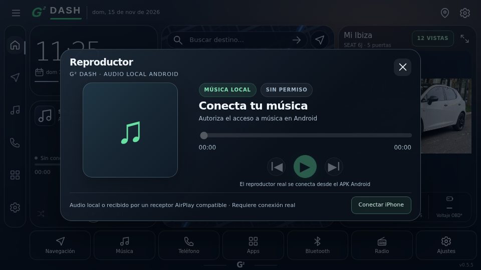
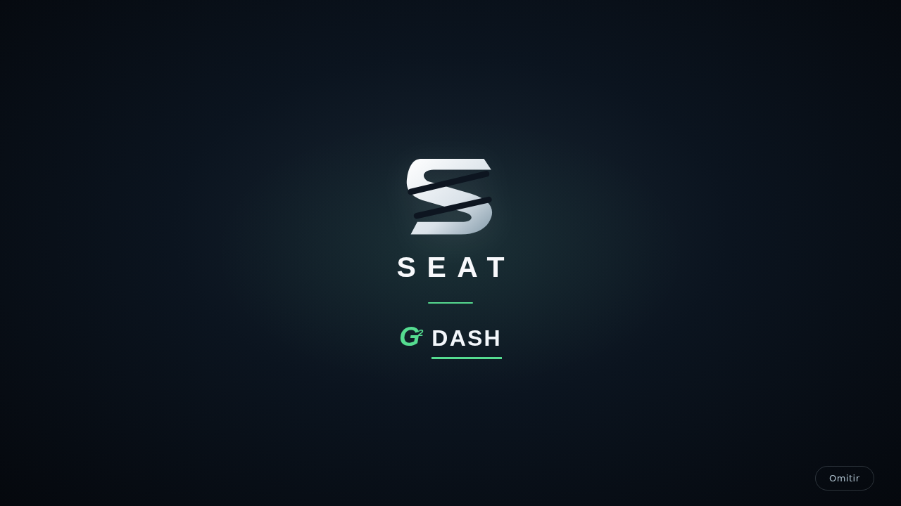
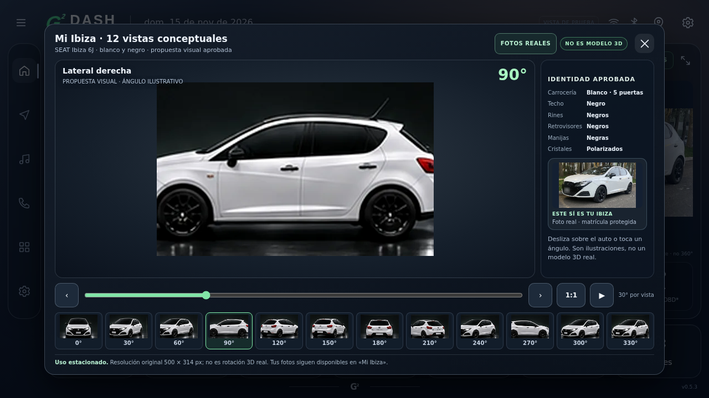
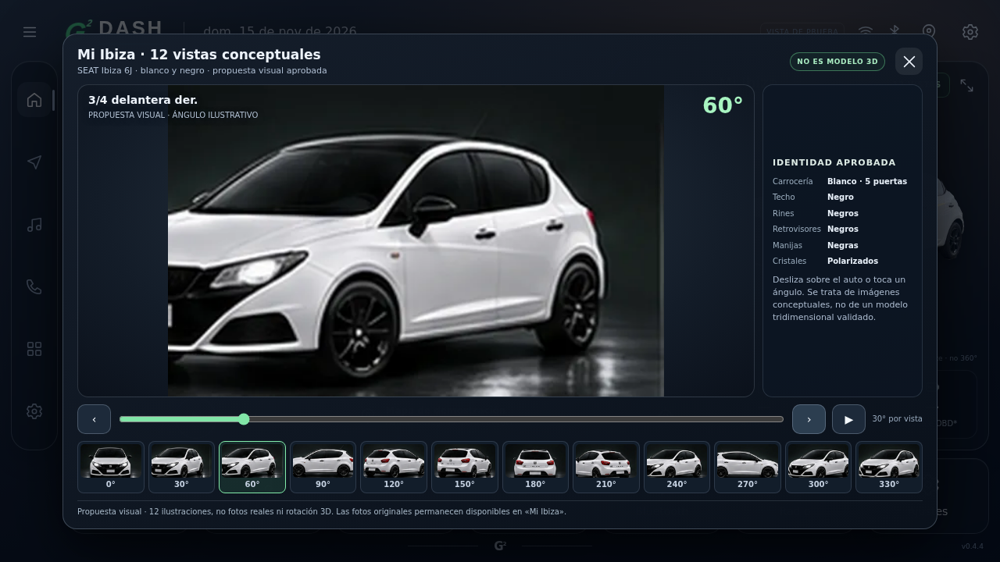

# G² Dash — Evidencia visual de cada actualización

Cada actualización en la rama principal dispara el flujo
[Capturas visuales](../../.github/workflows/capturas-visuales.yml), que abre **la
interfaz real en Chromium** a 1280 × 720 y crea capturas por sección.

> Importante: estas capturas representan el código real en GitHub.
> No son imágenes generadas, ni funciones simuladas como si fueran operativas.
> El mapa y OBD siguen pendientes. La música MediaSession local se integra opcionalmente en Android; las capturas musicales de ejemplo son únicamente pruebas visuales.

## Apps — v0.5.1

El panel de aplicaciones se probó en Chromium horizontal. En estas capturas aparecen **solo iconos ilustrativos de demostración**, no datos de apps instaladas. En Android se consulta el listado local real.

| Panel Apps 1280×720 | Buscador | Vista compacta 960×540 |
|---|---|---|
|  |  |  |

## Música — reproductor ampliado local v0.5.2

La vista ampliada se abre desde el botón junto al reproductor. Estas capturas muestran la **demostración web**, con etiquetas visibles y controles inactivos; no representan audio real.

| Reproductor 1280×720 | Vista compacta 960×540 |
|---|---|
|  |  |

En el APK Android, el panel lee la MediaSession local del estéreo. El avance y los controles aparecen solo cuando el reproductor admite esas acciones. La conexión del teléfono por Wi‑Fi sigue pendiente.

## Bienvenida y estado del proyecto — v0.5.2

Capturas obtenidas del HTML/CSS/JS real en Chromium horizontal.

| Logo SEAT + G² DASH | Saludo personalizado | Avance del proyecto |
|---|---|---|
|  |  |  |

La secuencia dura aproximadamente 4.6 segundos y se reproduce al abrir G² Dash; la tercera vista aclara qué está listo y que la música remota por Wi‑Fi sigue pendiente. El encendido automático del estéreo solo podrá verificarse en el dispositivo, tras seleccionar la app HOME si el fabricante lo permite.

## Ibiza — nitidez y controles v0.5.1

[**Comparación real 1:1 frente a 1.3×, con prueba de deslizamiento**](MEJORA_IBIZA_v0.5.1.md)

| Imagen nativa 1:1 | Ampliación 1.3× | Gesto táctil a 90° |
|---|---|---|
|  |  |  |

## Mi Ibiza — 12 vistas conceptuales (v0.5.0)

Imágenes de la galería real ejecutada en Chromium (los automóviles ilustrados proceden de la propuesta, no son fotografías del vehículo desde esos ángulos).

| Galería 12 vistas | Vista 60° | Trasera 180° |
|---|---|---|
|  |  |  |

[Captura compacta 1024 × 600](actual/20-ibiza-conceptual-1024x600.png)

## Comparación antes y después

[**Visor conceptual Ibiza 360 v0.5.0**](CAMBIOS_v0.5.0.md) · [Bienvenida y estado v0.4.5](CAMBIOS_v0.4.5.md) · [Mi Ibiza: fotos reales v0.4.4](CAMBIOS_v0.4.4.md) · [Historial de la máscara v0.4.2](RECORTE_IBIZA_v0.4.2.md)

**[Detalle Música v0.4.1 — comparación antes y después](DETALLE_MUSICA_v0.4.1.md)**

**[Ver cambios visuales v0.4 — Música, Ibiza y pantalla completa](CAMBIOS_v0.4.md)**


### Vista rápida de los paneles

| Música | Mi Ibiza |
|---|---|
|  |  |

| Ajustes | Modo día |
|---|---|
|  |  |

## Comprobación de resoluciones (v0.4.2)

La captura real de Chromium verifica que las secciones principales permanecen dentro del área de visualización, sin desbordamiento horizontal y con la foto del Ibiza cargada. Se prueban las siguientes resoluciones:

| Resolución | Captura real |
|---|---|
| **1280 × 720** · objetivo del estéreo | [Pantalla principal](actual/01-inicio-1280x720.png) |
| **1024 × 600** · versión compacta | [Tablero](actual/14-compacto-1024x600.png) · [Mi Ibiza](actual/15-ibiza-1024x600.png) |
| **960 × 540** · verificación adicional | [Tablero](actual/16-compacto-960x540.png) |

[Ver resultados de geometría en JSON](actual/qa-layout.json).

> Este control detecta cortes de las secciones principales, pero no sustituye las pruebas de fluidez, táctil, WebView y memoria RAM en el estéreo físico.

## Galería visual actual

| Sección | Evidencia |
|---|---|
| Bienvenida — logo | [00 — SEAT + G² DASH](actual/00-arranque-seat-logo.png) |
| Bienvenida — saludo | [00b — Doble G](actual/00b-arranque-saludo-doble-g.png) |
| Bienvenida — estado v0.5.2 | [00c — Avances y siguiente paso](actual/00c-arranque-estado-v052.png) |
| Vista principal completa | [01 — Inicio](actual/01-inicio-1280x720.png) |
| Marca, fecha y barra superior | [02 — Encabezado](actual/02-encabezado.png) |
| Hora y fecha | [03 — Reloj](actual/03-reloj.png) |
| Reproductor | [04 — Música](actual/04-musica.png) |
| Mapa de demostración | [05 — Mapa](actual/05-mapa-ilustrativo.png) |
| Vehículo original | [06 — Mi Ibiza](actual/06-mi-ibiza.png) |
| Iconos de acceso | [07 — Accesos](actual/07-iconos-accesos.png) |
| Fondo, opacidad y tonalidad | [08 — Personalización](actual/08-personalizacion.png) |
| Contraste claro | [09 — Modo día](actual/09-modo-dia-1280x720.png) |
| Fotografía frontal ampliada | [10 — Ibiza frontal](actual/10-ibiza-detalle.png) |
| Fotografía trasera ampliada | [11 — Ibiza trasera](actual/11-ibiza-trasera.png) |
| Música Android con metadatos de prueba (no reproducción real) | [12 — Vista de integración](actual/12-musica-integracion-prueba.png) |
| Música detallada v0.4.1 — ejemplo visual | [13 — Widget detallado](actual/13-musica-detallada-ejemplo.png) |
| Máscara revisada Ibiza | [14 — Panel](actual/14-ibiza-mascara-corregida.png) |
| Máscara revisada ampliada | [15 — Ampliación](actual/15-ibiza-mascara-ampliada.png) |

### Histórico de versiones

Los archivos en `actual/` se actualizan después de cada subida al código;
**Git conserva las capturas anteriores en el historial de commits**.
El archivo `actual/meta.json` identifica el commit del código
que produjo las capturas, la fecha y la resolución.

Para nuevas funciones: agregar una captura específica en
`scripts/capture-ui.mjs`, documentarla aquí y adjuntarla a la subida.
No incorporar capturas que expongan placas o datos personales sin anonimizar.

### Cómo generar capturas localmente

```bash
npm install
python3 -m http.server 8765
# En otra terminal:
node scripts/capture-ui.mjs
```

Chrome/Chromium debe estar instalado en el sistema, o debe descargarse
el navegador de Playwright con `npx playwright install chromium`.
