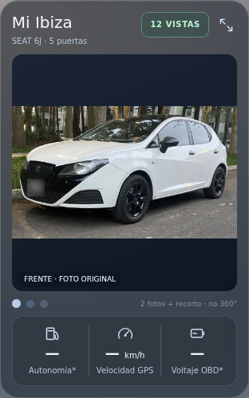
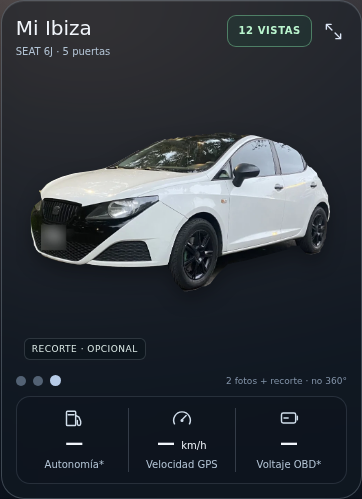
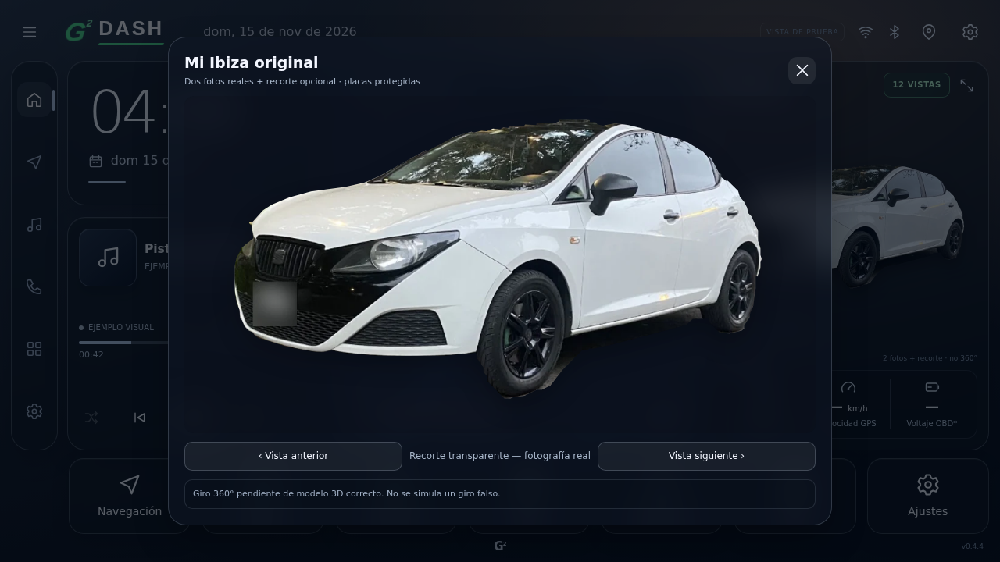

# G² Dash — Recorte de Mi Ibiza: antes y después

La versión anterior tenía **bloques de pavimento** alrededor de las llantas.
Se volvió a trazar la silueta para reducir ese error, sin tocar ni un píxel de
la fotografía original WebP incrustada: coche, color, carrocería, rines y
placa anonimizada siguen exactamente iguales.

| Antes — máscara defectuosa | Después — máscara revisada |
|---|---|
|  |  |

El coche es la fotografía real; **no es un render 3D ni una recreación**.
La máscara sigue siendo aproximada y se debe revisar visualmente antes de
considerarla final. El fondo general del launcher nunca fue modificado.
Las fotos completas Frontal y Trasera siguen disponibles.

[Ver galería completa](README.md) · [Volver al proyecto](../../README.md)
