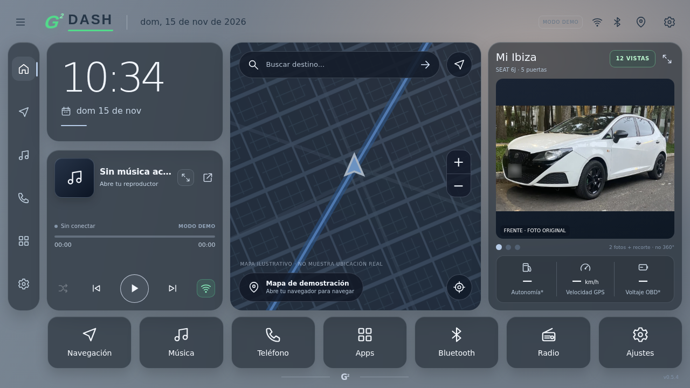
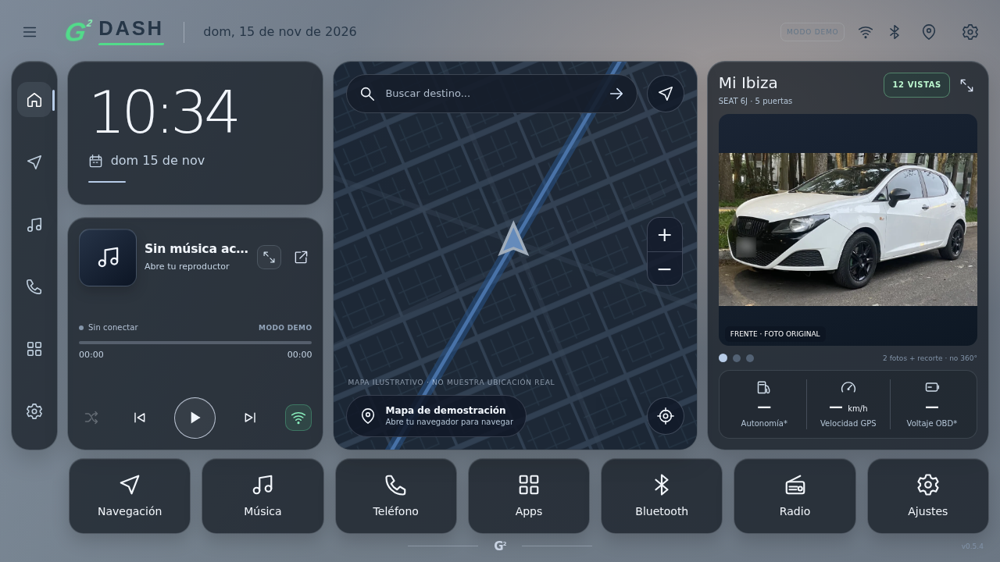
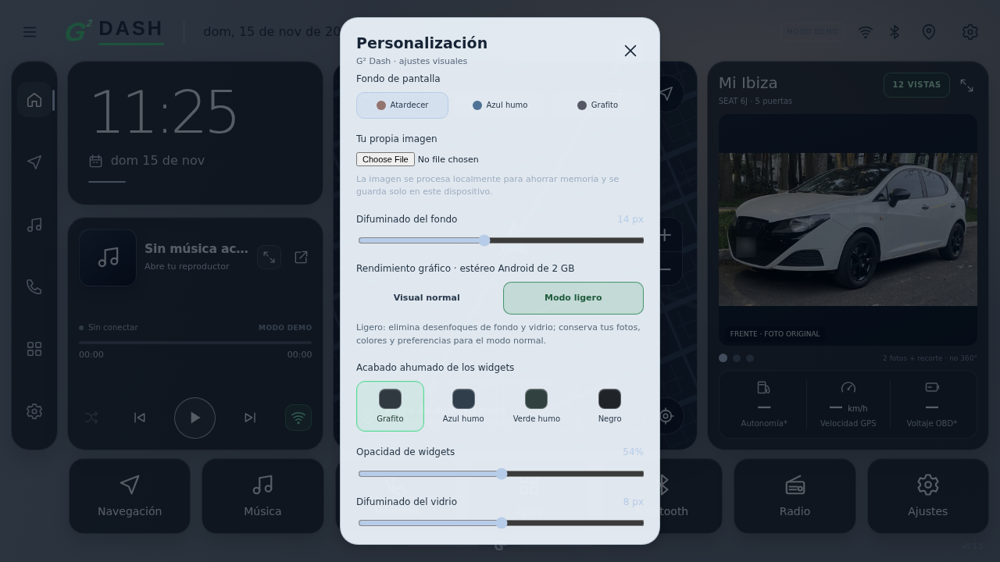

# G² Dash v0.5.4 — Visual normal vs. Modo ligero

## Comparación con capturas del código real

| Normal — conserva todos los desenfoques | Ligero — reduce filtros gráficos |
|---|---|
|  |  |

## Ajustes implementados

- Dos opciones persistentes: **Visual normal** y **Modo ligero**.
- Ligero desactiva el `backdrop-filter` de paneles y botones, y el `filter:blur` del wallpaper; reduce algunas sombras y transiciones decorativas.
- Mantiene la misma composición, las fotos originales, los WebP conceptuales, las tonalidades, el mapa ilustrativo y el estado de los módulos.
- Restaura los valores personalizados de opacidad y difuminado al volver a Normal.
- Verifica automáticamente que el fondo y el vehículo no cambien y que la elección se guarde en `localStorage`.

**Limitación:** son optimizaciones de CSS, no una medición de uso de RAM, batería o FPS. Se necesita validar en el estéreo Gearelec de 2 GB.

[Galería completa](README.md) · [Proyecto principal](../../README.md)
